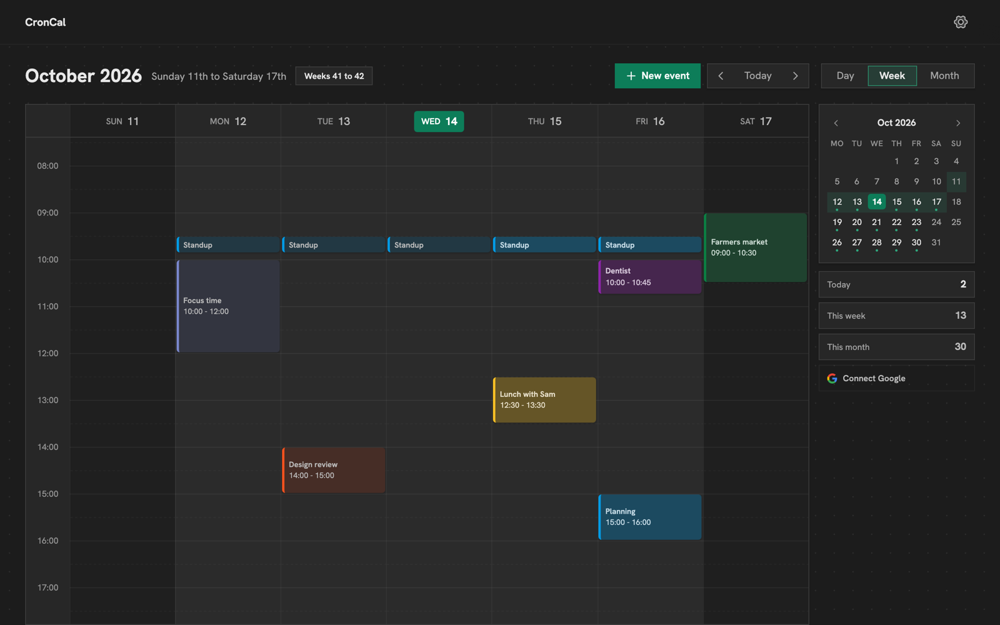

# CronCal

A calendar with repeats, drag to move and two-way Google Calendar sync. It runs on your computer, and your events live in your own free Supabase project. Nothing goes to anyone else's server, except Google's if you connect it.



- **Day, week and month**, with the week centred on today so the days around it are always in view.
- **Drag** an event to another time or day, and drag across empty time to make one.
- **Repeats** every day, weekday, week, two weeks, month or year. Change one day, that day and the ones after it, or all of them.
- **Time zones**: each event keeps its own, and shows in yours.
- **Colours, a type and an importance** on every event, and its link, place and people.
- **Google Calendar**, both ways: your Google events show beside CronCal's, and changes go back to Google.
- **Nine themes**, and it works on a phone.

Free to use and change for yourself ([Licence](#licence)). To work on the code, see [CONTRIBUTING.md](CONTRIBUTING.md).

## Install

You need a Mac, Windows or Linux computer, [Node.js](https://nodejs.org) (the LTS version), and a free [Supabase](https://supabase.com) account (no card). It takes about ten minutes, once. Google Calendar takes about ten more, if you want it.

On Windows, leave Node's "Automatically install the necessary tools" box unticked: CronCal doesn't need them.

### Download

Paste one line into **Terminal** (Mac or Linux) or **Command Prompt** (Windows, not PowerShell). It makes a `croncal` folder where you are, and opens CronCal in your browser a few seconds later.

Mac and Linux:

```bash
curl -fsSL https://github.com/emehta/croncal/releases/latest/download/croncal.zip -o croncal.zip && unzip -q croncal.zip && rm croncal.zip && cd croncal && npm start
```

Windows:

```bat
curl -fsSL https://github.com/emehta/croncal/releases/latest/download/croncal.zip -o croncal.zip && tar -xf croncal.zip && del croncal.zip && cd croncal && npm start
```

### With Git

```bash
git clone https://github.com/emehta/croncal.git && cd croncal && npm install && npm start
```

This builds CronCal on your computer first, which takes about a minute.

Either way, CronCal opens at **http://localhost:3102**. Keep the window that started it open: closing it stops CronCal.

## Connect Supabase

CronCal's first screen, **Set up CronCal**, walks you through it:

1. **Make a project.** Sign in at [supabase.com](https://supabase.com/dashboard/projects) (a new account first asks you to name an organisation: any name, Free plan). On **Create a new project**, choose a name, a database password and the region nearest you, then press **Create new project**.
2. **Copy the Project URL** from the project's home page (**Copy** beside the address under its name) into CronCal.
3. **Copy both keys** from **API Keys**: the **Publishable key** (`sb_publishable_`) and the one under **Secret keys** (`sb_secret_`; press the eye to show it). Press **Connect**.
4. **Add the tables.** Press **Copy the setup**, open the **SQL Editor** (if Supabase shows a note about snippets, press **Understood**), paste, press **Run**, then **Check again** in CronCal.
5. **Make your account.**

Already use [Todoer](https://github.com/emehta/todoer)? Give CronCal the same project: after step 4 it asks you to sign in with your Todoer account instead of making one.

Then switch off sign-ups, so the project stays yours: in Supabase, **Authentication**, **Sign In / Providers**, switch off **Allow new users to sign up**, then **Save changes**. Strangers could see none of your events anyway; Settings reminds you until it's off.

Leave **Enable Data API** on (**Integrations**, **Data API**): CronCal talks to your project through it.

The secret key is saved only on your computer, in a file only your account can read:

- Mac: `~/Library/Application Support/CronCal`
- Windows: `%LOCALAPPDATA%\CronCal`
- Linux: `~/.config/croncal`

## Google Calendar

CronCal connects through a Google Cloud client of your own, so no one else's app sits between you and your calendar. It's free. Sign in at [console.cloud.google.com](https://console.cloud.google.com) with your Google account, then:

1. **Make a project.** Open the project picker at the top, press **New project**, name it CronCal, and press **Create**. Make sure it's the project selected.
2. **Turn on the Calendar API.** Search the console for **Google Calendar API**, open it, and press **Enable**.
3. **Name the app.** In the menu, open **Google Auth platform**, then **Branding**. If it says **Google Auth platform not configured yet**, press **Get started**: App name CronCal, your email as the support and contact email, **External** under Audience, then agree to the policy and press **Create**.
4. **Publish it,** so the connection doesn't end after seven days: open **Audience** and press **Publish app**. Only you will use it, so it needs no review.
5. **Make the client.** Open **Clients**, press **Create client**, choose **Web application**, and under **Authorized redirect URIs** press **Add URI** and paste `http://localhost:3102/api/auth/google/callback` (CronCal's Settings shows it, ready to copy). Press **Create**, and keep the window with the **Client ID** and **Client secret** open.
6. **Connect.** In CronCal, open **Settings**, paste both under **Google Calendar**, press **Save**, then **Connect**. Choose your account. Google says it hasn't verified the app, because it's yours rather than a published one: press **Advanced**, then go on to CronCal, tick calendar access, and continue.

Your Google events then show beside CronCal's, with an eye in the sidebar to hide them. A new event goes into Google too, unless you switch off **Sync to Google Calendar** in its form.

## Open it again

Double-click **Start CronCal.command** (Mac) or **Start CronCal.cmd** (Windows) in the `croncal` folder. It opens CronCal, or the copy already running.

To open it like an app: Safari's **File → Add to Dock**, or Chrome's **Install** icon in the address bar.

## Your data

- **Back up** with Settings → **Download my data**: every CronCal event in one file. Supabase's free plan keeps no backups, so do it now and then. Google's events stay in Google. CronCal can't read the file back in yet.
- **A paused project:** Supabase pauses a free project after a week unused. Press **Restore project** there, then **Try again** in CronCal.
- **Another project:** stop CronCal, delete `config.json` from the folder above, and start it again. Your events stay in the old project.

## Update

Close CronCal's window first. Your events and settings are kept.

- **Downloaded:** delete the `croncal` folder (`rm -rf croncal` on Mac or Linux, `rmdir /s /q croncal` on Windows), then run the download line again.
- **With Git:** in the `croncal` folder, run `git checkout main && git pull && npm install && npm start`.

If an update changes the tables, CronCal asks you to run the setup again. Nothing is lost.

## Something not working

- **"Supabase isn't answering":** check you're online, and that the project isn't [paused](#your-data).
- **"Another program is using port 3102":** start on another port with `npm start -- --port 3106`. Google's redirect URI must then use that port too.
- **Google says "redirect_uri_mismatch":** the URI in step 5 must match the one in CronCal's Settings exactly.
- **Forgot your password:** press **Forgot password?** on the sign-in screen and paste your project's secret key.
- **Windows says npm isn't recognised:** open a new Command Prompt after installing Node.
- **PowerShell says "running scripts is disabled":** use Command Prompt, or type `npm.cmd` for `npm`.

## Remove it

1. Delete the `croncal` folder, and the settings folder [above](#connect-supabase).
2. If you added it like an app: delete Safari's from the **Applications** folder in your home folder, or open Chrome's and choose **Uninstall CronCal** from its ⋮ menu.
3. If you connected Google: in Settings press **Disconnect** first, and delete the Google Cloud project if you made one only for CronCal.
4. If you're done with Supabase, delete the project there.

## Licence

[PolyForm Noncommercial 1.0.0](LICENSE.md): use it, change it and share it for yourself or any non-commercial purpose. Don't sell it or use it in a business.

Copyright Eshaan Mehta.
